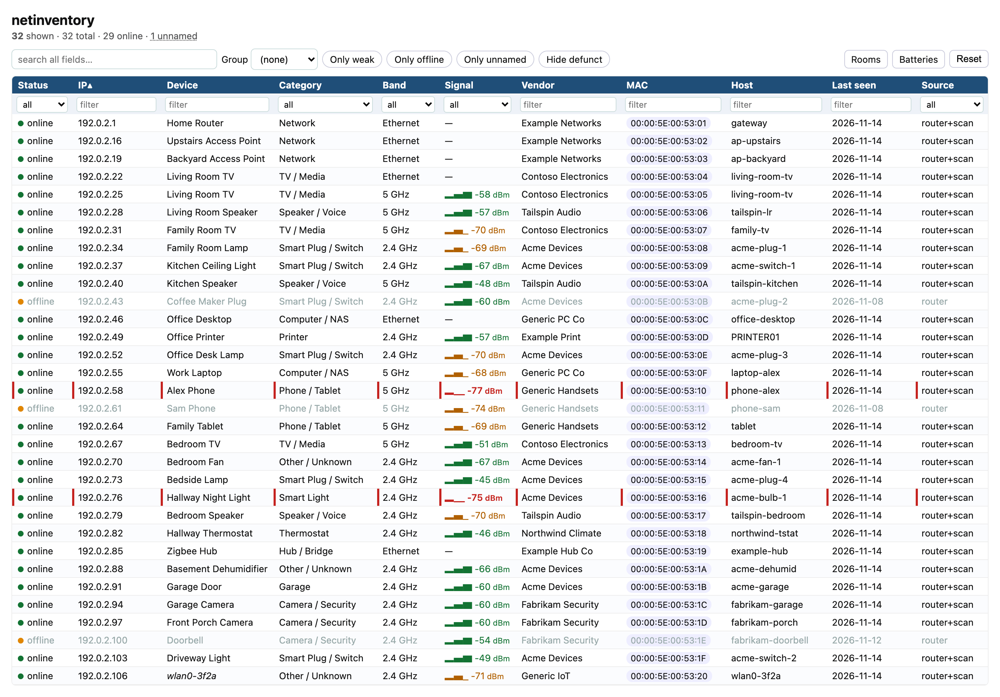
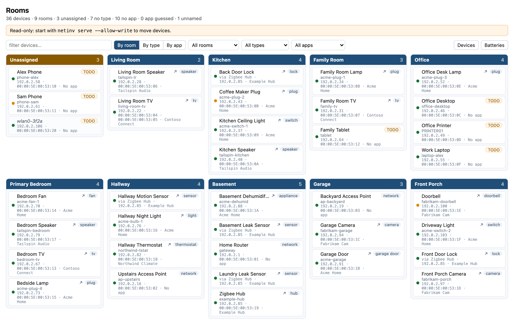
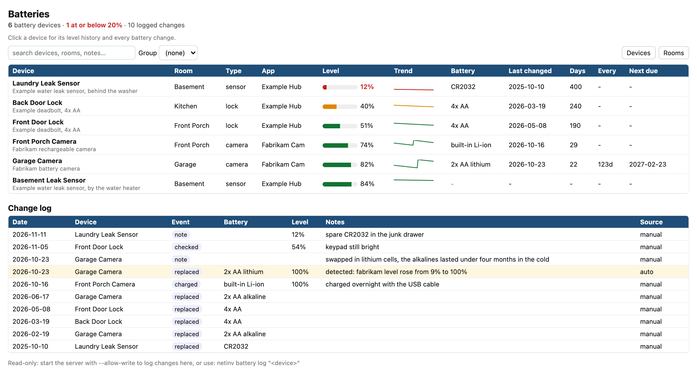
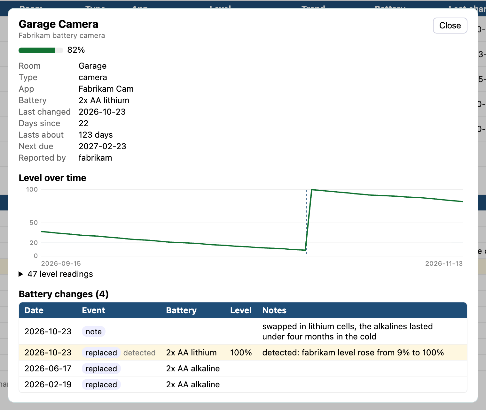
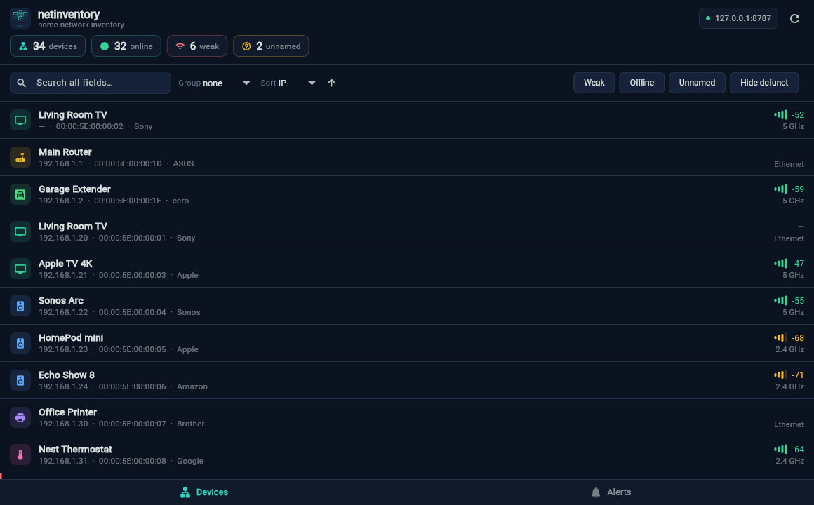
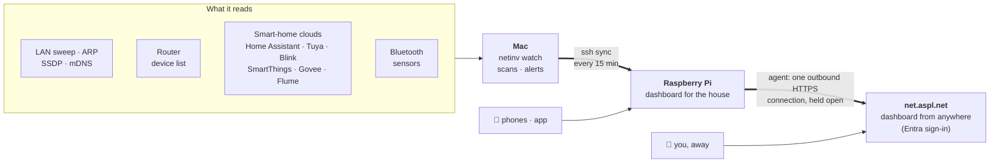

<p align="center">
  
</p>

<h1 align="center">netinventory</h1>

<p align="center"><b>Every device on your network, named and accounted for.</b></p>

<p align="center">
  <a href="https://github.com/jchirayath/netinventory/actions/workflows/ci.yml"></a>
  
  
  
  <a href="LICENSE"></a>
</p>

<p align="center">
  <a href="https://netinventory.aspl.net"><b>Website</b></a> ·
  <a href="#features">Features</a> ·
  <a href="#screenshots">Screenshots</a> ·
  <a href="#how-it-runs">How it runs</a> ·
  <a href="#quick-start">Quick start</a> ·
  <a href="docs/architecture.md">Architecture</a> ·
  <a href="docs/threat-model.md">Threat model</a>
</p>

<p align="center">
  
</p>

A home network inventory: a **scanner engine** for a Mac or a Raspberry Pi, a
**web dashboard**, and a **macOS/iOS companion app**. Devices are keyed by MAC
address, so names survive DHCP churn. It finds devices through the router, SSDP,
mDNS and smart-home clouds, identifies unknown ones, watches the devices you care
about, and tracks their batteries.

## Features

<table>
<tr>
<td width="50%" valign="top">

### 🔎 Find everything
nmap/ARP sweep, SSDP/UPnP, mDNS/DNS-SD (works on randomized MACs), Spotify
Connect and the router's device list, then the apps' own APIs for the
details a network can't show: battery, online state, model and the name you
gave it. [See what each app gives you](#works-with-your-smart-home-apps).

</td>
<td width="50%" valign="top">

### 🏷️ Names that stick
One row per MAC. Names you give are never overwritten by a rescan; a device's
wired and Wi-Fi MACs group under one name; devices gone 30+ days age out as
`defunct`. Unknowns get an OUI vendor lookup and a port/banner fingerprint.

</td>
</tr>
<tr>
<td valign="top">

### 🔔 Alerts that matter
`watch` mails or notifies on new devices, address changes and long-absent
devices returning. **Monitors** watch the devices you pick and alert once when
one stays offline or its battery runs low, and once on recovery: by ping, TCP
port, vendor cloud or Bluetooth.

</td>
<td valign="top">

### 🔋 Battery tracking
Levels from Home Assistant, Tuya, Blink, Flume, Govee and Bluetooth sensors.
A change log with battery type and notes, replacements **detected
automatically**, how long a set lasts and when the next change is due. Click a
device for its level chart and every reading.

</td>
</tr>
<tr>
<td valign="top">

### 🏠 One home standard
`home.csv` gives every device a room, a type and one name across Home
Assistant, SmartThings, Google Home, Alexa, Apple Home and Smart Life; `home
push` renames devices in an app to match. The rooms board lets you drag
devices between rooms, types and apps.

</td>
<td valign="top">

### 🌐 Three copies, in step
The Mac scans, a Raspberry Pi serves the house, and a web copy serves you
anywhere behind an Entra sign-in. The Pi keeps the web copy current over **one
outbound connection** (nothing on the internet connects into the house), and
an edit on any copy reaches the others.

</td>
</tr>
<tr>
<td valign="top">

### 🔐 Secure by default
Read-only unless you turn edits on; edits from other devices need a passcode,
stored only as a salted scrypt hash, with a per-client lockout. Every edit and
wrong passcode goes in an audit trail. Security headers on every page; CI
blocks committing network data or a real MAC.

</td>
<td valign="top">

### ♻️ Looks after itself
The Pi pulls `main` nightly, runs the full test suite on the Pi, and switches
only if the tests pass and both services come back, otherwise it rolls back.
Writes are atomic, so a crash never leaves a half-written file.

</td>
</tr>
</table>

## Works with your smart-home apps

**Built in today**

| How it connects | Sources |
|---|---|
| Smart-home apps, through their APIs | Home Assistant · Blink · Flume · Tuya / Smart Life · Govee (developer API) · Govee app account · SmartThings · Wyze · Apple (iCloud) |
| On your own network | Kasa (no account) · nmap sweep and ARP · SSDP / UPnP · mDNS / Bonjour · Spotify Connect · Xfinity gateway's device list · OUI vendor lookup and port fingerprinting |
| Over Bluetooth | Govee thermometers (battery) · any device you match, for presence |

A network scan sees an address and a vendor. Your smart-home apps know far
more: what you named each device, its model, its battery, and whether it's
really online, even for sensors that never touch Wi-Fi. netinventory signs in
to each app's API with your own account and merges that detail into the same
row, matched by MAC wherever the app reveals one.

| App | What netinventory reads | Sign-in |
|---|---|---|
| **Home Assistant** | Every battery entity from any integration it runs, the device's MAC where HA knows it, and names; `home push --to ha` sets names and areas back | URL + long-lived token |
| **Blink** | Each camera and doorbell: name, model, battery (OK / low), signal bars, online (including its sync module), last check-in; MAC and IP where Blink reports them, and `blink-locate` wakes each camera to learn the rest | account + 2FA code |
| **Flume** | The water sensor and its bridge: battery level and whether each is connected | API client ID and secret + account |
| **Tuya / Smart Life** | App name, MAC and IP (from a local scan), battery and online; `home push --to tuya --rooms-only` files devices into rooms | Tuya IoT project ID and secret |
| **Govee** | App name and model, with MAC and IP for devices with LAN Control on; the Govee account adds battery and online for leak sensors behind a hub | API key, or account + emailed code |
| **SmartThings** | Device labels, the MAC of LAN devices; `home push --to smartthings --rooms-only` files devices into rooms | personal access token |
| **Wyze** | Nickname and MAC | API key + account |
| **Kasa** | Name, MAC and IP, over the local network | none |
| **Apple** | Your device roster: name and model | Apple ID + app-specific password |
| **Bluetooth** | Battery and presence of Govee thermometers this Mac can hear | none |

```bash
cd engine && python3 -m venv .venv
./.venv/bin/python -m pip install -r requirements-cloud.txt   # only the SDKs you use
./.venv/bin/netinv set-cloud blink      # asks for the sign-in, stores it in the Keychain
./.venv/bin/netinv cloud                # pull names and details from every app set up
./.venv/bin/netinv monitor suggest      # propose battery and offline monitors from them
```

Sign-ins live in the macOS Keychain (an owner-only file on Linux), never in the
repo or a config file. Battery levels are read hourly by `watch` and kept as a
history, so the Batteries page can tell how long a set lasts. Per-app setup
notes are in [engine/README.md](engine/README.md#smart-home-cloud-connectors).

## Screenshots

<table>
<tr>
<td width="50%"><br><sub><b>Rooms board.</b> Drag a device to another room, type or app.</sub></td>
<td width="50%"><br><sub><b>Batteries.</b> Worst first, grouped by room, type or app, with the change log.</sub></td>
</tr>
<tr>
<td><br><sub><b>Battery history.</b> The level chart, every reading and every change; the jump is a detected replacement.</sub></td>
<td><br><sub><b>Companion app.</b> The same data on macOS and iOS, with a Batteries tab.</sub></td>
</tr>
</table>

<p align="center"><sub>Every screenshot uses a fictional demo home (RFC 7042 documentation MACs, RFC 5737 addresses), never a real scan. <a href="engine/tools/">engine/tools/</a> regenerates them.</sub></p>

## How it runs



The Mac has the radios and the CPU for scanning. The Pi is always on, so the
dashboard stays up when the Mac sleeps, and its agent keeps the web copy in step
without anything on the internet connecting into the house. Edits merge
everywhere: within seconds from the web to the Pi, and at the next 15-minute
sync to the Mac.

| Part | What it is |
|---|---|
| [`engine/`](engine/) | Python scanner, CLI and dashboard server (`netinv serve`): JSON API `/api/devices·summary·alerts·events·monitors·board·batteries` and pages `/`, `/rooms`, `/batteries` |
| [`app/`](app/) | Flutter macOS/iOS companion, a viewer and editor over the engine's API |
| [`deploy.sh`](deploy.sh) | installs or updates the engine on a Pi over ssh |
| [`scan-jobs.sh`](scan-jobs.sh) | keeps the watch and the dashboard running on a Mac (LaunchAgents) |
| [`docs/`](docs/) | [architecture](docs/architecture.md) (the jobs, units, sync rules, logs, where to look) · [threat model](docs/threat-model.md) · [home standard](docs/home-standard.md) |

## Quick start

```bash
cd engine
python3 netinv.py update --scan        # scan + merge + report
python3 netinv.py serve                 # dashboard on http://127.0.0.1:8787
python3 -m unittest discover -s tests   # tests (stdlib only)
```

<details>
<summary><b>Cloud connectors, Excel reports, edits from your phone</b></summary>

```bash
cd engine && python3 -m venv .venv
./.venv/bin/python -m pip install -e '.[all]'
./.venv/bin/netinv update --scan --cloud
./.venv/bin/netinv set-passcode              # then: netinv serve --lan --allow-write
```

`serve --lan` shares the dashboard with your network; with `--allow-write`,
edits from any device but this one need the passcode. Editing is off by
default, and the write path sends no CORS header, so other sites can't reach it.
Full engine docs: [`engine/README.md`](engine/README.md).

</details>

<details>
<summary><b>A Raspberry Pi and a web copy</b></summary>

`./deploy.sh user@pi` installs the engine on a Pi and `netinv sync` keeps edits
in step between copies ([engine/README.md](engine/README.md#keeping-two-copies-in-step-a-raspberry-pi)).
`netinv agent` keeps a server copy in step over one outbound connection. How the
home setup runs all three is in [docs/architecture.md](docs/architecture.md).

</details>

<details>
<summary><b>Rooms and names for every smart-home app</b></summary>

[`docs/home-standard.md`](docs/home-standard.md) is the one standard for which
room each device is in, what type it is, and its name in Home Assistant,
SmartThings, Google Home, Alexa, Apple Home and Smart Life. `netinv home draft`
seeds it from `devices.csv`; `netinv home check` validates it.

</details>

<details>
<summary><b>The app</b></summary>

```bash
cd app
flutter run -d macos          # or a connected iPhone
```

On macOS it reads `http://127.0.0.1:8787`; on iOS it points at the engine's LAN
address. Docs: [`app/README.md`](app/README.md). Apple Developer team
`VKUYJ3BS76`, bundle `com.aspl.net.netinventory`.

</details>

## Privacy

All real network data lives under `engine/` and is git-ignored: `devices.csv`,
reports, `inventory.xlsx`, `events.csv`, `home.csv`, `rooms.csv`,
`monitors.csv`, the battery log and history, `audit.csv`, SSIDs and router
cookies. Credentials are in the macOS Keychain, or in an owner-only
`~/.netinv/credentials.json` on Linux. CI fails if any data file or real MAC is
committed. To report a vulnerability, see [SECURITY.md](SECURITY.md).

## Brand

The mark is a scanner hub with three discovered nodes over a sweep, drawn as
vector geometry rather than shipped as art: `assets/brand/netinventory-icon.png`
(1024 px master), `assets/brand/netinventory-logo.svg` (flat mark), and
`BrandMark` in `app/lib/widgets.dart`, a `CustomPainter` that stays crisp at any
size. App icons are generated from that geometry
([app/README.md](app/README.md#icons)).

## License

MIT
