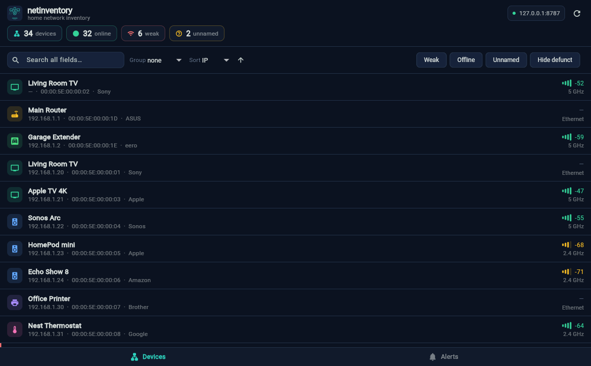

<p align="center">
  
</p>

<h1 align="center">netinventory</h1>

<p align="center"><em>Every device on your network, named and accounted for.</em></p>

Home network device inventory: a **scanner engine** (Mac or Raspberry Pi), a
**web dashboard**, and a **macOS/iOS companion app**. It is keyed by MAC address
so it survives DHCP churn. It finds devices through the router, SSDP, mDNS and
smart-home clouds, fingerprints unknown ones, watches the devices you care
about, and tracks their batteries.

```
netinventory/
├── engine/      → Python scanner engine + CLI + dashboard server
├── app/         → Flutter macOS/iOS companion (a viewer/editor over the engine's API)
├── docs/        → the home standard: rooms, types and names across smart-home apps
├── deploy.sh    → install/update the engine on a Pi over ssh
├── scan-jobs.sh → keep the watch and the dashboard running on a Mac (LaunchAgents)
└── assets/      → brand mark + app screenshots
```

## Features

- **Inventory that survives DHCP.** One row per MAC, friendly names that a
  refresh never overwrites, several MACs (wired + Wi-Fi) grouped under one
  device, Wi-Fi band per device, and `defunct` ageing for devices gone 30+ days.
- **Discovery from everywhere.** nmap/ARP sweep, SSDP/UPnP names, mDNS/DNS-SD
  (works on randomized MACs), Spotify Connect, the Xfinity gateway's device
  list, and smart-home clouds: Tuya/Smart Life, Wyze, Blink, SmartThings,
  Apple, Govee, Kasa, Flume and Home Assistant.
- **Identify unknowns.** OUI vendor lookup plus an active port/banner
  fingerprint; `pairs` finds a device's wired and Wi-Fi MACs; `blink-locate`
  wakes each Blink camera to learn its MAC.
- **Join alerts.** `watch` polls every few minutes and emails or notifies on new
  devices, IP/hostname changes and long-absent devices coming back, with a
  join/leave history in `events.csv`.
- **Device monitors.** An on/off list of devices to watch, with one alert when one
  stays offline too long or its battery runs low, and one on recovery. Presence
  is checked by ping, a TCP port, the vendor cloud or a Bluetooth scan.
- **Battery tracking.** Levels from Home Assistant, Tuya, Blink, Flume, Govee and
  Bluetooth sensors, a log of battery changes with type and notes, replacements
  detected automatically, how long a set lasts and when the next change is due.
  The list groups by room, type or app.
- **One home standard.** `home.csv` gives every device a room, a type and one name
  across Home Assistant, SmartThings, Google Home, Alexa, Apple Home and Smart
  Life. `home push` renames devices in an app to match.
- **Dashboard and app.** Devices, a rooms board (drag devices between rooms,
  types and apps) and Batteries pages in the browser; the same data in the
  companion app. Edits are opt-in and need a passcode from any other device.
- **Two copies in step.** A Raspberry Pi serves the dashboard; the Mac scans and
  syncs its results to the Pi. Edits made on either side merge back.
- **Private by design.** Network data is git-ignored, credentials stay in the
  Keychain (or an owner-only file on Linux), and CI blocks committing a data
  file or a real MAC.

<p align="center">
  
</p>
<p align="center">
  <sub>The companion app. Every screenshot in this repo uses fictional demo
  devices (RFC 7042 documentation MACs) — never a real scan.</sub>
</p>

## Architecture

The engine is the scanner (Python + nmap/arp/SSDP/router scrape/cloud). It can't
run on iOS, so the split is deliberate:

- **`engine/`** runs on a Mac or a Raspberry Pi. `netinv serve` exposes a JSON
  API (`/api/devices|summary|alerts|events|monitors|board|batteries`) plus a web
  dashboard (`/`, `/rooms`, `/batteries`). Editing from the dashboard/app is opt-in:
  `netinv serve --allow-write` (off by default; the write path sends no CORS
  header, so cross-site pages can't reach it). `serve --lan` shares it with
  your phone; edits from other devices then need the passcode
  (`netinv set-passcode`).
- **`app/`** is the viewer. On macOS it reads `http://127.0.0.1:8787`; on iOS
  (which can't scan) it points at the agent's LAN IP.
- **`deploy.sh`** installs or updates the engine on another machine (a Pi) over
  ssh, and `netinv sync` keeps your edits in step between the copies. See
  [`engine/README.md`](engine/README.md#keeping-two-copies-in-step-a-raspberry-pi).

The recommended home setup splits the work:

```
  Mac (scans)                                  Raspberry Pi (serves)
  watch: sweep, router, clouds,   sync every   serve --lan --allow-write
  Bluetooth, monitors, alerts  ── 15 min ───▶  dashboard + API for phones/app
  scan data, levels, events    ◀────────────   edits: names, notes, battery log,
                                                rooms, monitors
```

The Mac has the radios and the CPU for scanning. The Pi is always on, so the
dashboard stays up when the Mac sleeps. Scanner mode (`sync_scanner = yes`)
sends the Mac's scan results to the Pi, and edits made on the Pi merge back.

## Quick start

**Engine (local runs, Python):**
```bash
cd engine
python3 netinv.py update --scan        # scan + merge + report
python3 netinv.py serve                 # JSON API + dashboard on :8787
python3 -m unittest discover -s tests   # tests (stdlib only)
```
Optional cloud/xlsx features use a venv:
```bash
cd engine && python3 -m venv .venv
./.venv/bin/python -m pip install -e '.[all]'
./.venv/bin/netinv update --scan --cloud
```
Full engine docs: [`engine/README.md`](engine/README.md).

**Rooms and names for every smart-home app:** [`docs/home-standard.md`](docs/home-standard.md)
is the one standard for which room each device is in, what type it is, and the
name it has in Home Assistant, SmartThings, Google Home, Alexa, Apple Home and
Smart Life. `netinv home draft` seeds the registry from `devices.csv`;
`netinv home check` validates it.

**App (macOS/iOS):**
```bash
cd app
flutter run -d macos          # or a connected iPhone
```
App docs: [`app/README.md`](app/README.md). Uses Apple Developer team
`VKUYJ3BS76`, bundle `com.aspl.net.netinventory`.

## Brand

The mark is a scanner hub with three discovered nodes over a sweep, drawn as
vector geometry rather than shipped as art:

| | |
|---|---|
| `assets/brand/netinventory-icon.png` | 1024px master, dark tile |
| `assets/brand/netinventory-logo.svg` | flat mark, transparent |
| `app/lib/widgets.dart` → `BrandMark` | the same mark as a `CustomPainter`, so the in-app logo stays crisp at any size and needs no raster asset |

App icons (7 macOS sizes, 15 iOS) are generated from that geometry — see
[`app/README.md`](app/README.md#icons) for how to regenerate them after a change.

## Privacy

All real network data lives under `engine/` and is git-ignored: `devices.csv`,
reports, `inventory.xlsx`, `events.csv`, `home.csv`, `rooms.csv`,
`monitors.csv`, the battery log and history, SSIDs and router cookies.
Credentials are in the macOS Keychain, or in an owner-only
`~/.netinv/credentials.json` on Linux. CI fails if any data file or real MAC
is committed. See [`analysis-report.md`](analysis-report.md) for the productization
roadmap and status.

## License

MIT
