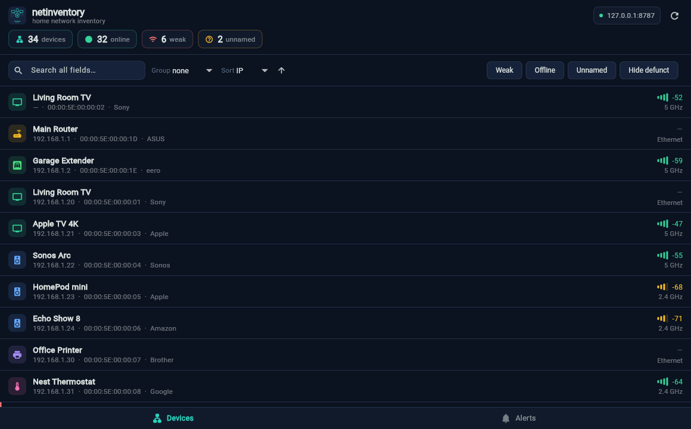
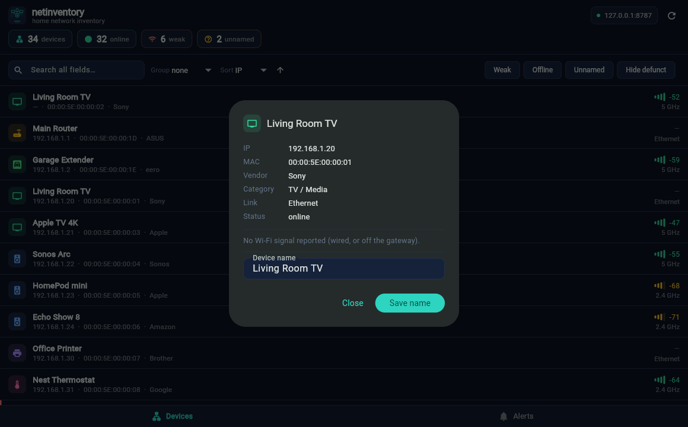

<p align="center">
  
</p>

<h1 align="center">netinventory-app</h1>

macOS + iOS companion for [netinventory](https://github.com/jchirayath/netinventory).
Flutter app that reads the read-only JSON API served by `netinv serve` and shows
your network inventory — a searchable device list (group / sort / filter by
status, band, category and signal), a rollup summary, and alerts.

<p align="center">
  
</p>

## Model

The Python engine (netinventory) is the **scanner agent** and runs on a Mac
(`netinv serve` exposes `/api/devices|summary|alerts|events`). This app is the
**viewer**:

- **macOS**: talks to the local agent at `http://127.0.0.1:8787`.
- **iOS**: can't scan (sandbox); tap the host chip in the header and point it at
  the Mac's LAN IP.

## Run

```bash
# on the Mac, start the agent API:
cd ../engine && python3 netinv.py serve        # http://127.0.0.1:8787

# the app:
flutter run -d macos        # or: flutter run -d <iphone>
```

Renaming a device from the app needs the agent's opt-in write path:
`netinv serve --allow-write`. Without it the rename returns 403 and the app
says so rather than failing silently.

## The interface

Built for taking in a whole subnet at a glance rather than for browsing, so it
is deliberately dense — 52px rows, a single-line control bar, and a stat strip
in place of a chrome-heavy app bar.

- **Stat strip** — devices / online / weak / unnamed, straight off `/api/summary`.
- **Category glyphs** — 18 device categories mapped to an icon in a tinted tile
  (plus a fallback), so the list is scannable without reading a word
  (`categoryIcon` in `theme.dart`). The tint derives from the category name, so
  a kind of device always looks the same.
- **Signal meter** — a four-bar meter coloured good / fair / weak beside the dBm
  reading and band. Wired devices show `—`.
- **Weak** devices get a red left edge; **offline** rows dim and carry a status
  tag; **unnamed** devices carry an `unnamed` tag so they are easy to hunt down.
- **Tabular figures** on IPs, MACs and dBm so the columns line up vertically.
- **Grouping** by band / category / status / signal, with collapsible headers
  showing per-group counts and average RSSI.
- Dark theme by default; a light theme is built and switchable via `themeMode`.

<p align="center">
  
</p>

Tap any row for the detail sheet: the full record, a plain-language reading of
the signal ("Weak — likely cause of drops & failed DHCP"), and inline rename.

## Layout

```
lib/
├── main.dart      → view logic (group/sort/filter — unit-tested), API client, screens
├── theme.dart     → brand tokens, light/dark themes, category → icon/tint
└── widgets.dart   → BrandMark, SignalBars, StatPill, CategoryBadge
```

The pure view-logic functions at the top of `main.dart` (`viewRows`,
`passDevice`, `cmpDevice`, `grpKey`, `deviceName`, `ipNum`) are deliberately
top-level and widget-free so `test/view_logic_test.dart` can exercise them with
no running app and no network. Keep them that way.

The control bar switches to a stacked layout below 900px — the single-row
version overflows on a phone.

## Icons

App icons are generated from the same geometry as `BrandMark`, so the in-app
logo and the launcher icon cannot drift apart. After changing the mark, redraw
both sets — 7 macOS sizes (16→1024, alpha) and 15 iOS sizes (opaque, **no**
alpha, as the App Store requires) — and leave the filenames in each
`AppIcon.appiconset/Contents.json` unchanged.

## Signing

Uses Apple Developer team `VKUYJ3BS76`, bundle `com.aspl.net.netinventory`
(same account as the other apps). `flutter build macos/ios` compiles and
ad-hoc-signs from the CLI; for a team-signed + notarized build, open
`macos/Runner.xcworkspace` (or `ios/Runner.xcworkspace`) in Xcode once so
automatic signing registers the App ID.

## Tests

```bash
flutter analyze
flutter test          # 10 tests: view logic + a build smoke test
```

CI runs both on every push. The smoke test asserts the string `netinventory`
renders, so keep the wordmark a plain `Text` — wrapping it in `Text.rich` or
`RichText` makes `find.text` miss it.

## Screenshots

Point the engine at throwaway data before capturing anything — never publish a
shot of a real scan:

```bash
mkdir -p /tmp/demo && cp ../engine/devices.example.csv /tmp/demo/devices.csv
NETINV_HOME=/tmp/demo python3 ../engine/netinv.py serve
```

`screencapture` cannot grab the native macOS window without Screen Recording
permission; `flutter build web` in a scratch copy and shooting that in a browser
is the reliable route.

## Requirements

- Flutter 3.41+
- macOS entitlements: `app-sandbox` + `network.client`
- iOS: `NSAllowsLocalNetworking` + Local Network usage (set in Info.plist)
