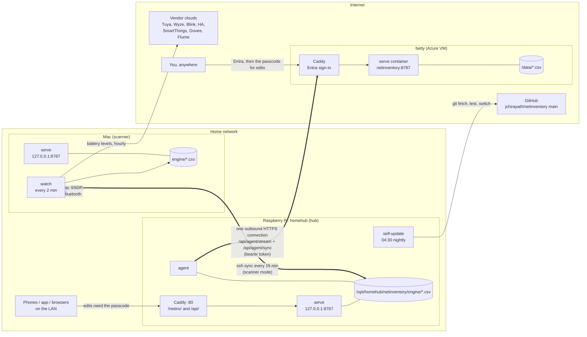
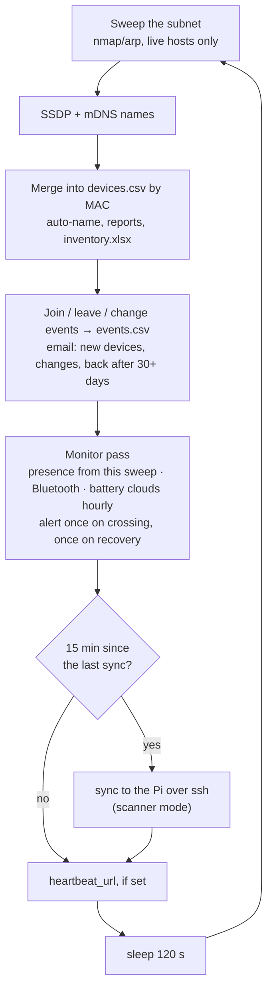

# How netinventory runs

Three copies of the same engine, each with one job:

| Where | Job | Runs | Reached at |
|---|---|---|---|
| **Mac** | scans: the network, the vendor clouds, Bluetooth; sends alerts | `watch` and `serve` as LaunchAgents | `http://127.0.0.1:8787` (this Mac only) |
| **Raspberry Pi** (homehub, `192.168.1.204`) | always-on dashboard for the house; keeps the web copy in step | `serve`, `agent` and a nightly self-update as systemd units | `http://192.168.1.204/netinv/` (LAN) |
| **betty** (Azure VM) | the dashboard from anywhere | `serve` in a Docker container behind Caddy | `https://net.aspl.net` (Entra sign-in) |

The Mac does all the scanning, because it has the radios and the CPU and the Pi's SD
card shouldn't take the writes. The Pi is the hub: the Mac syncs into it, and it keeps
net.aspl.net in step. Edits made on any of the three end up on all three.



Every arrow starts on the side that opens the connection. Nothing on the internet can
open a connection into the house: the Pi's agent connects out to betty, and the Mac
connects out to the Pi.

## The Mac: the scanner

Two LaunchAgents, managed by [`scan-jobs.sh`](../scan-jobs.sh). They start at login and
launchd restarts them if they die.

| LaunchAgent | Command | Log |
|---|---|---|
| `com.netinventory.watch` | `netinv.py watch --interval 120 --no-router --email` | `engine/netinv-watch.log` |
| `com.netinventory.serve` | `netinv.py serve --allow-write` (loopback only) | `engine/netinv-serve.log` |

Each `watch` poll (every 120 s) does the following, in order:



Two rules keep a bad poll from turning into bad data:

- **A scan that hears nobody** (Wi-Fi down, the Mac away from home) changes nothing.
  No device is marked offline, no 'leave' events are logged, ping/tcp monitors aren't
  judged, and the heartbeat isn't sent, so an outside check notices. The log says
  `WARN poll #N: the scan heard nothing`.
- **An alert counts as sent only once the email goes out.** If it fails, the alert waits
  in `monitor_state.json` and goes with the next poll's email, marked with when it was
  raised.

The settings come from `~/.netinv/config`:

```ini
[netinv]
sync_target  = jacobc@192.168.1.204:/opt/homehub/netinventory
sync_scanner = yes
```

| Interval | Setting | Default |
|---|---|---|
| network poll | `watch --interval` | 120 s (from scan-jobs.sh) |
| battery clouds | `monitor_cloud_every` | 1 h |
| sync to the Pi | `sync_every` | 15 min |

Commands:

```bash
./scan-jobs.sh status | restart | logs
./scan-jobs.sh serve-start | serve-stop
```

After a `git pull`, run `./scan-jobs.sh restart` so the watch picks up the new code.

## The Pi: the hub

Units from the [homehub repo](https://github.com/jchirayath/homehub) (`netinventory/`).
`./netinventory/update.sh` installs them; [`deploy.sh`](../deploy.sh) is the generic
installer for any other Pi.

| Unit | What | Writes to the SD card |
|---|---|---|
| `netinventory.service` | `netinv serve --host 127.0.0.1 --port 8787 --allow-write`, reached only through Caddy (`/netinv/`, `/api/`) | only on edits and syncs |
| `netinventory-agent.service` | `netinv agent`: keeps net.aspl.net in step (below) | only when something changed |
| `netinventory-update.timer` → `.service` | 04:30 nightly: `/opt/homehub/netinventory-self-update.sh` | only on a new version |

The Pi never scans: there is no scan timer, by design (SD card wear). Its scan data,
battery levels and events all come from the Mac's sync. The code and data both live in
`/opt/homehub/netinventory/engine/`, and homehub's nightly `backup.sh` keeps a copy of
`devices.csv`.

**Nightly self-update.** It connects out to GitHub and does nothing unless `main` has
moved. When it has, the script checks out the new commit, reinstalls the engine, and runs
the engine's full test suite on the Pi (about 30 s). It then restarts `netinventory` and
`netinventory-agent`. If the tests fail, or either service isn't active within 30 s, it
puts the previous commit back. It logs one line at warning level when it updates or rolls
back (`journalctl -t netinventory-update`). To hold a version:
`sudo systemctl disable --now netinventory-update.timer`.

## net.aspl.net: the copy on the web

The copy on betty is a Docker service in the compose project at `/home/azureuser/podcast`:

- image: `python:3.12-slim`, running as an unprivileged user
- code: mounted read-only
- data: `netinventory-data/`, mounted at `/data`
- hardening: `read_only`, `cap_drop: ALL`
- network: only Caddy can reach it

Caddy's site `sites/net.aspl.net.caddy` routes requests two ways:

| Path | Gate |
|---|---|
| `/api/agent/sync`, `/api/agent/stream` | none in Caddy; serve requires the agent's bearer token |
| everything else | Entra sign-in (`entra-auth`), then serve; edits also need the passcode |

The code isn't updated automatically. After netinventory changes reach `main`, run this
from a Mac logged in with `az login`:

```bash
engine/deploy-betty.sh            # ship the committed engine, restart, verify the gates
engine/deploy-betty.sh --check    # only verify the gates
```

## How the copies stay in step

### Mac → Pi: ssh, every 15 minutes

`netinv sync user@host:path` runs the Pi's own `netinv.py sync-export` and
`sync-import` over ssh. It merges each file by its rule, and keeps the last synced state
in `.sync/<target>/` next to the data, for three-way merges.

| File | Rule |
|---|---|
| `battery_log.csv` | by entry Id; the newer `Updated` wins; deletions travel as tombstones |
| `battery_history.csv` | the union of both |
| `monitors.csv`, `home.csv`, `rooms.csv`, `types.csv`, `apps.csv` | three-way merge against the last synced copy; a field changed on both sides takes the side written last |
| `devices.csv` | three-way, but only the fields you curate (`Device`, `Notes`); a sync never deletes a scanned device |
| `monitor_state.json`, `events.csv`, `app_rooms.csv` | scanner mode only: the Mac's copy replaces the Pi's |

### Pi ⇄ net.aspl.net: the agent

The agent uses the same pattern as poolhound's agent: one outbound connection, nothing
inbound.

```mermaid
sequenceDiagram
  participant P as Pi: netinv agent
  participant C as betty: Caddy
  participant S as betty: serve
  P->>C: GET /api/agent/stream (Bearer token)
  C->>S: proxied, unbuffered
  Note over P,S: held open; ": ping" every 25 s; closed and reopened every 10 min
  Note over S: someone logs a battery change on net.aspl.net
  S-->>P: event: sync
  P->>S: POST /api/agent/sync {op: export, have: fingerprints}
  S-->>P: only the files that changed (gzipped)
  Note over P: three-way merge, scanner mode (the Pi pushes scan data up)
  P->>S: POST /api/agent/sync {op: import, files, expect: fingerprints}
  alt betty's files changed since the export
    S-->>P: 409 Conflict (the agent retries, up to 3 times)
  else
    S-->>P: 200
  end
```

- It syncs when betty signals an edit, and every `agent_every` (5 min) regardless, so the
  Mac's fresh scan data reaches the web within about 5 minutes of reaching the Pi.
- An idle sync sends only fingerprints. It moves no file contents and writes nothing to
  the SD card.
- The token lives in each side's credentials store. `netinv agent-token` prints its
  fingerprint, so you can compare the two sides without showing the token.
- net.aspl.net's dashboard shows `synced from the Pi <time>` next to the device count,
  so stale data is visible: if that time is old, the agent has stopped.
- Every sync, over ssh or https, checks this copy's files before writing the merge. An
  edit saved here mid-sync (serve runs in its own process) makes the sync start over, so
  the merge never overwrites it.

### How long an edit takes to reach each copy

| Edit made on | Reaches the Pi | Reaches net.aspl.net | Reaches the Mac |
|---|---|---|---|
| Mac (`127.0.0.1:8787`) | next sync, ≤ 15 min | ≤ 5 min after the Pi | — |
| Pi (`/netinv/`) | — | ≤ 5 min | next sync, ≤ 15 min |
| net.aspl.net | ~5 s (the stream nudges the agent) | — | next sync, ≤ 15 min |

## Who can do what

| Copy | Read | Edit |
|---|---|---|
| Mac | this Mac (loopback) | this Mac |
| Pi | anyone on the home LAN | the passcode (`X-Netinv-Passcode`), from the dashboard or the app |
| net.aspl.net | after an Entra sign-in | Entra, plus the same passcode |
| agent token | nothing outside `/api/agent/*` | sync only |

Other protections serve applies on every copy:

- **Host header allow-list:** stops DNS rebinding (`NETINV_SERVE_HOSTS` adds names).
- **Origin and Content-Type checks on every POST:** stops cross-site requests.
- **Security headers:** a Content-Security-Policy and `X-Frame-Options: DENY`, so no
  other site can frame the pages.
- **Passcode lockout:** 10 wrong passcodes in 10 minutes locks that client out for 10
  minutes, counted per client.
- **Separate token lockout:** wrong agent tokens have their own count.
- **Proxy headers:** `X-Forwarded-For` is trusted only from loopback and
  `NETINV_TRUSTED_PROXIES`.
- **Read timeout:** a client that connects and then goes quiet is dropped after 30 s.

The passcode is stored as a salted scrypt hash. A plain value left by an older version
is converted the first time serve starts. Credentials stay in the macOS Keychain, or in
an owner-only `credentials.json` on Linux. Sync never carries them, and betty holds only
the agent token and the passcode hash (`creds-export --only agent,serve`).

The full list of assets, attackers, boundaries and known gaps is in
[threat-model.md](threat-model.md).

## Logs and the audit trail

The long-running commands (`watch`, `serve`, `agent`) write one line per event, with a
timestamp and a level:

```
2026-11-13 14:30:59 INFO  poll #412: 63 online, 0 new, 1 changed, 0 left, 0 back
2026-11-13 14:31:02 WARN  heartbeat: <urlopen error timed out>
2026-11-13 14:45:10 ERROR alert email failed, 1 alert(s) kept for the next pass: SMTP: (535 …)
```

`grep -E 'WARN|ERROR'` finds every problem. Output is line-buffered, so lines reach
journald, `docker logs` or the Mac's log file as they happen.

| Copy | Where the log goes |
|---|---|
| Mac | `engine/netinv-watch.log`, `engine/netinv-serve.log` |
| Pi | `journalctl -u netinventory`, `-u netinventory-agent`, `-t netinventory-update` |
| betty | `sudo docker logs podcast-netinventory-1` |

**What serve logs:** refused and failed requests only (4xx and 5xx, with the client
address), so a guesser or a bug is visible while successful reads cost the SD card
nothing.

**The audit trail:** every edit through serve, and every refused edit, adds a line to
`audit.csv` in the data directory:

| Column | Holds |
|---|---|
| Time | when |
| Who | this machine, the client's address, or the agent |
| Action | e.g. `battery-log`, `rename` |
| Target | the device, MAC or entry |
| Status | the HTTP answer |
| Detail | for the agent: which files it wrote |

`audit.csv` stays on its own copy (sync never carries it, so the agent can't rewrite it).
Past 1 MB it moves to `audit.csv.1` and a new one starts.

## Where to look when something is off

| Symptom | Look at |
|---|---|
| Pi dashboard stale | Mac: `./scan-jobs.sh logs` for `sync with` lines; is the watch running (`./scan-jobs.sh status`)? |
| Everything shows its old status | Mac log: `the scan heard nothing` means the Mac can't see the network |
| net.aspl.net stale | its `synced from the Pi` time; then on the Pi, `journalctl -u netinventory-agent -n 50` |
| Edits refused with 401 | the passcode; after 10 misses wait 10 minutes. `audit.csv` shows who was refused |
| Who changed this? | `audit.csv` on the copy where the edit was made |
| Pi on old code | `journalctl -t netinventory-update`; `git -C /opt/homehub/netinventory log -1` |
| betty on old code | `engine/deploy-betty.sh --check`; the `REVISION` file next to the code on betty |
| No alerts from the Mac | `engine/netinv-watch.log`; email settings (`netinv email-setup`) |
